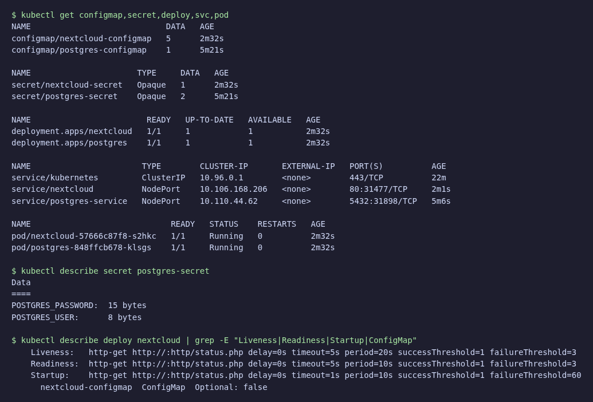
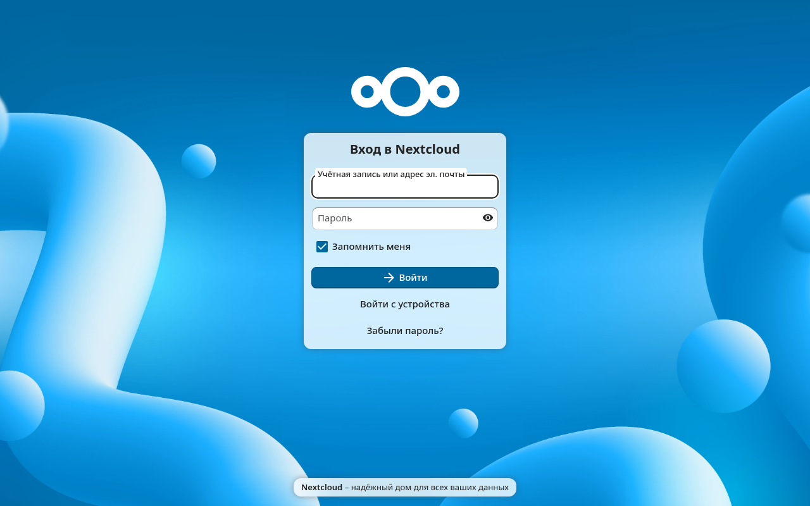
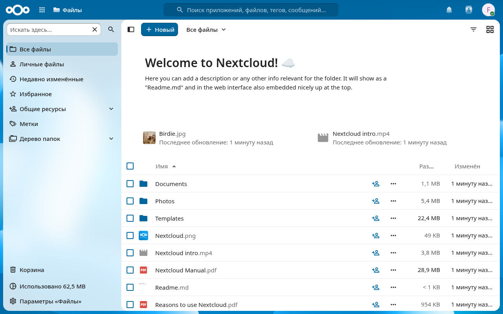
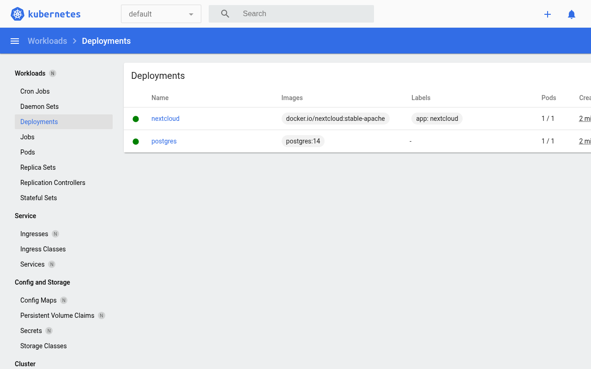
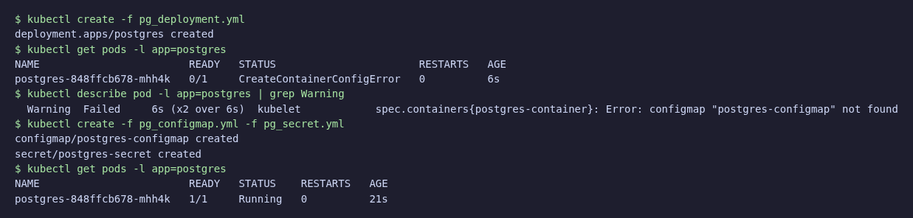
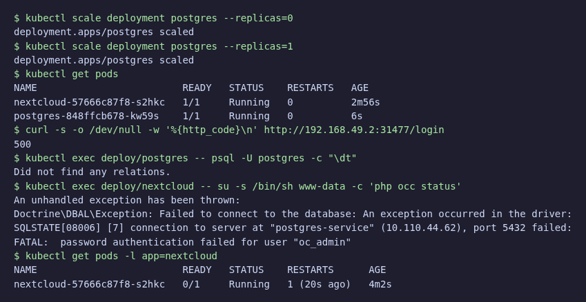

# ЛР 3. Kubernetes

minikube v1.39.0 (driver docker), kubectl v1.37.2.

```bash
minikube start --driver=docker
kubectl create -f pg_configmap.yml -f pg_secret.yml -f pg_service.yml -f pg_deployment.yml
kubectl create -f nextcloud.yml
kubectl expose deployment nextcloud --type=NodePort --port=80
minikube service nextcloud
```

Изменения относительно примера:

- `POSTGRES_USER`, `POSTGRES_PASSWORD` перенесены в Secret `postgres-secret` (`pg_secret.yml`), Postgres берёт их через `envFrom.secretRef`, Nextcloud через `secretKeyRef`
- переменные Nextcloud (`NEXTCLOUD_UPDATE`, `ALLOW_EMPTY_PASSWORD`, `POSTGRES_HOST`, `NEXTCLOUD_TRUSTED_DOMAINS`, `NEXTCLOUD_ADMIN_USER`) перенесены в ConfigMap `nextcloud-configmap`
- у Nextcloud добавлены startup, liveness и readiness пробы на `/status.php`. В пробах указан заголовок `Host: localhost`: без него kubelet шлёт IP пода, которого нет в trusted domains, и Nextcloud отвечает 400
- лимит памяти Nextcloud поднят с 256Mi до 512Mi: при первом входе контейнер падал с `OOMKilled`
- `/var/www/html` вынесен в `emptyDir`: без него после рестарта контейнера (OOM или liveness) Nextcloud пытается установиться заново поверх уже заполненной БД и падает









## Ответы на вопросы

**Важен ли порядок выполнения манифестов?** Для работы в итоге нет: Kubernetes декларативен, kubelet повторяет попытки, пока объект не появится. Но если Deployment создан раньше ConfigMap/Secret, под висит в `CreateContainerConfigError` и запускается только после их создания. Service можно создавать в любой момент, он находит поды по selector. Поэтому удобнее создавать ConfigMap и Secret первыми.



**Что будет, если отскейлить postgres в 0, а потом в 1?** Старый под удаляется, создаётся новый с пустой БД: у Postgres нет volume, данные лежали в файловой системе контейнера. Nextcloud при установке создал в БД свои таблицы и пользователя `oc_admin`, их больше нет, поэтому Nextcloud отвечает 500, readiness-проба выводит под из Service, liveness перезапускает контейнер, но это не помогает. Решение: PersistentVolumeClaim для `/var/lib/postgresql/data`.


