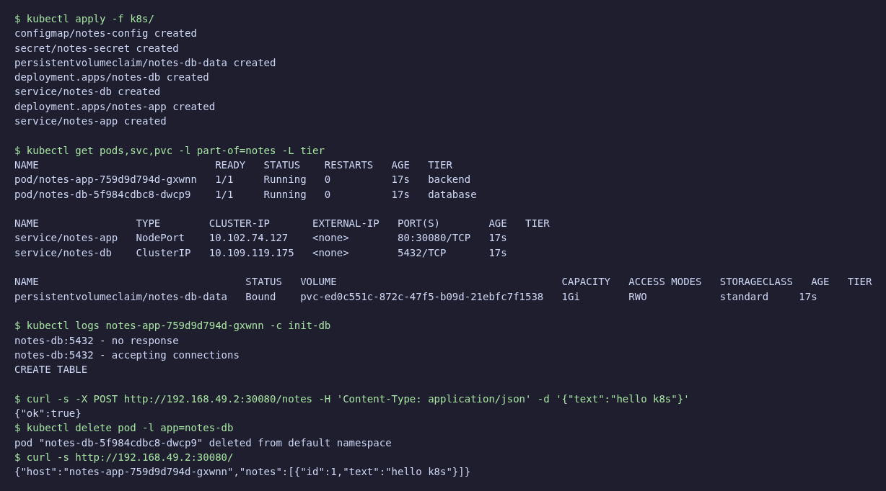
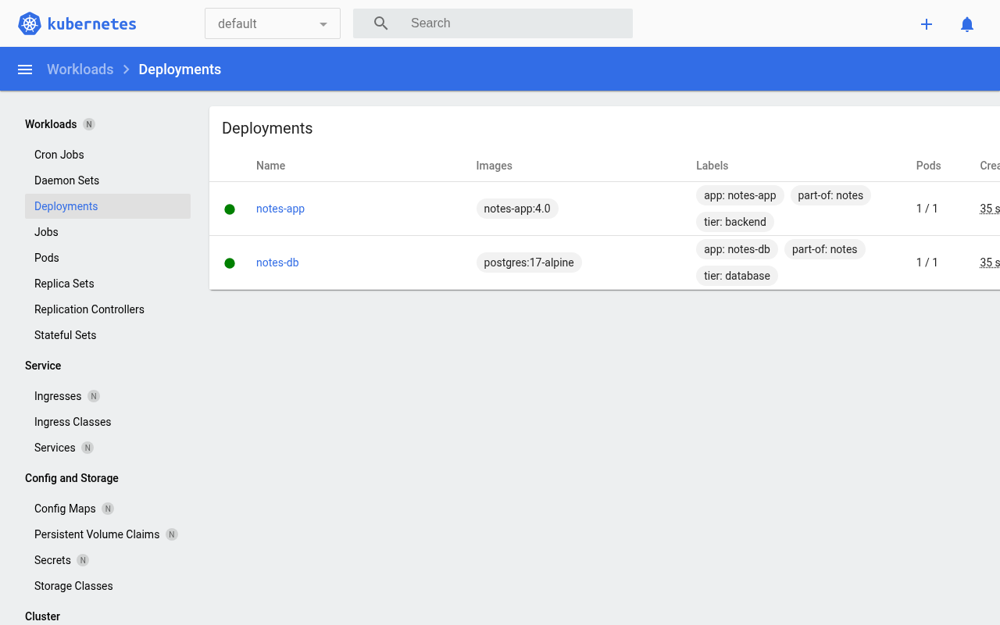

# ЛР 4. More Kubernetes

Приложение из ЛР 2 в minikube.

```bash
minikube image build -t notes-app:4.0 .
kubectl apply -f k8s/
minikube service notes-app
```

| Файл | Объекты |
|------|---------|
| `k8s/1-config.yml` | ConfigMap `notes-config` (хост и имя БД), Secret `notes-secret` (логин и пароль) |
| `k8s/2-postgres.yml` | PVC `notes-db-data`, Deployment `notes-db` (volume из PVC), Service `notes-db` |
| `k8s/3-app.yml` | Deployment `notes-app`: свой образ `notes-app:4.0`, init-контейнер `init-db` (ждёт БД и создаёт таблицу через `psql`), liveness `/healthz`, readiness `/readyz`; Service `notes-app` (NodePort 30080) |

Лейблы `app`, `tier`, `part-of` на всех объектах, выборка по ним: `kubectl get pods -l part-of=notes`.

Данные лежат в PVC и переживают удаление пода БД:




